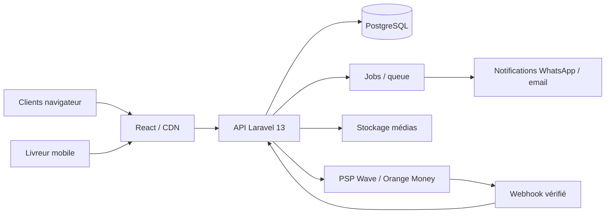

# Technical Requirements Document — Architecture technique

**MK DÉLICES** — Dossier de cadrage fonctionnel et technique

**Document 02/12** · Version 1.0 · 14 novembre 2026

---

## Gouvernance du document

| Champ | Valeur |
|---|---|
| Projet | MK Délices — Plateforme e-commerce pâtisserie |
| Version | 1.0 — cadrage initial du 14 novembre 2026 |
| Statut | Proposition de référence ; à valider par MK Délices |
| Localisation | Dakar, Sénégal |
| Monnaie / fuseau | XOF / Africa/Dakar (UTC+0) |
| Socle préconisé | React + TypeScript + Vite ; Laravel 13 / PHP ≥ 8.3 ; PostgreSQL |
| Hypothèses | Catalogue, prix, zones, frais, prestataires et identité visuelle à confirmer |

**Convention :** « DOIT » = exigence impérative ; « DEVRAIT » = souhaitable ; « option » = hors MVP ou à arbitrer. Les exemples de tarifs, d'adresses, de parfums et de durées ne constituent jamais des données commerciales officielles. Toutes les valeurs monétaires sont enregistrées en unités entières de XOF.


## 1. Principes et choix techniques

Architecture **monolithe modulaire** : SPA React/TypeScript/Vite sur domaine web, API REST Laravel 13 et PostgreSQL. PHP 8.3 minimum selon documentation Laravel 13. Redis facultatif (cache/queues), stockage compatible S3 facultatif. Une seule source de vérité des commandes, montants et états. Les traitements de paiement doivent être testables avec un prestataire simulé.

## 2. Vue logique et déploiement



**Frontière de confiance :** le frontend ne décide jamais des prix, des statuts, de l identité ni de la validité d un paiement. Toutes les écritures sont authentifiées ou protégées par jeton invité et contrôles de débit.

## 3. Modules backend et responsabilités

| Module | Responsabilités | Interfaces |
| --- | --- | --- |
| Catalog | Catégories, produits, variantes, allergènes, images | GET /catalog et /products |
| Checkout | Panier, prix snapshot, réservations | POST /checkout |
| Order | États, transitions, journal, annulation | GET/PATCH /orders |
| Payment | Adaptateurs PSP, webhooks, rapprochement | /payments, /webhooks |
| Delivery | Zones, tarifs, affectations, preuve de remise | /delivery |
| CMS | Pages, bannières, horaires, FAQ | /content |
| Identity | Comptes, permissions, sessions | /auth, /admin/users |
| Analytics | Agrégats calculés depuis états fiables | /admin/stats |

## 4. Organisation du code

```text
backend/app/Domain/{Catalog,Checkout,Orders,Payments,Delivery,Content,Identity,Analytics}/
backend/app/Http/{Controllers/Api/V1,Requests,Resources,Middleware}/
backend/app/Policies/
backend/app/Jobs/
backend/database/{migrations,seeders,factories}/
backend/tests/{Feature,Unit}/
frontend/src/{app,features,components,lib,api,routes,styles}/
frontend/tests/{unit,e2e}/
```

Les contrôleurs délèguent aux services applicatifs ; les policies vérifient la propriété de la ressource ; les repositories ne doivent pas masquer inutilement Eloquent. Utiliser transactions DB sur validations et réservations.

## 5. Authentification et sécurité de session

Personnel et livreurs : session Sanctum via cookies HttpOnly Secure SameSite et CSRF en contexte first-party ; aucun token dans localStorage. Acheteur invité : identifiant de panier signé et lien de suivi secret à expiration, rate limiting et vérification téléphonique possible. Support multirôle avec autorisation serveur systématique. Désactiver tout accès administrateur depuis une inscription publique.

## 6. Intégration des paiements

Interface PaymentGateway {createSession, fetchStatus, refund, validateWebhook}. Implémentations WaveGateway, OrangeMoneyGateway ou PSP agrégateur selon contrat. **Webhooks** : conserver l’événement brut expurgé de secrets, vérifier authentification, dédupliquer external_event_id, effectuer transaction avec verrouillage commande et paiement, basculer état uniquement sur confirmation vérifiable, répondre rapidement 2xx puis traiter job. Si succès navigateur sans webhook fiable : état « en vérification ». Réconciliation automatique planifiée. Ne pas prétendre connaître une API non contractée.

Wave publie une Checkout API et des webhooks ; Orange Business Sénégal propose une API Internet avec procédure de souscription. Les détails d intégration dépendent des accès marchand. Sources : https://docs.wave.com/checkout et https://espaceclientv2.orange.sn/orange-money/api-internet.

## 7. Intégration WhatsApp

MVP : lien wa.me avec texte encodé contenant référence du brouillon, sans donnée personnelle superflue. Le brouillon est sauvegardé côté serveur ; le marchand le confirme dans le back-office. Évolution : WhatsApp Business Platform officielle, modèles approuvés, consentement, limites et facturation. Les messages ne doivent pas contenir de secrets ou jetons de session.

## 8. Non fonctionnel, traitements et incidents

| Sujet | Conception / seuil proposé |
| --- | --- |
| Cache | Catalogues cacheables avec invalidation à la publication |
| Images | WebP/AVIF, variantes responsives, limite de poids, suppression métadonnées |
| File d attente | Email et notifications, retries exponentiels, dead-letter à prévoir |
| Concurrence | Index unique et SELECT FOR UPDATE sur transitions/quotas |
| Idempotence | Idempotency-Key commande et paiement + hash charge utile |
| Logs | trace_id, order_id, actor_id, jamais numéros complets ni clés PSP |
| API | Pagination plafonnée ; erreurs RFC 9457 ou format stable documenté |
| Disponibilité | Page de dégradation si PSP indisponible, statut paiement conservé |

## 9. Environnements, livraison et vérification

DEV Windows/Laragon, TEST sandbox PSP et dataset factice, PROD Linux/HTTPS. Variables : APP_ENV, APP_KEY, DB_URL, SESSION_DOMAIN, SANCTUM_STATEFUL_DOMAINS, PSP_PROVIDER, PSP_KEY, WEBHOOK_SECRET, WA_NUMBER, STORAGE_DISK, QUEUE_CONNECTION. Secrets injectés hors Git. Pipeline : lint, types, PHPUnit/Pest, tests JS, build, migrations sous sauvegarde, smoke test. Tester montage Laravel 13 avec PHP 8.3+ et extensions requises.

## 10. Décisions techniques ouvertes

- Choisir hébergeur, DNS, stockage objet et système de mail.
- Valider fournisseur de paiement, contrat, webhooks et sandbox.
- Confirmer traitement des coupons, TVA et politique de facture applicable.
- Choisir méthode de vérification téléphone pour les commandes à risque.
- Définir disponibilité réelle et plafond de commandes par créneau.

## Références et réserves

**Sources externes de vérification (consultées le 14/11/2026) :**
- https://laravel.com/framework/docs/13.x/releases
- https://docs.wave.com/business
- https://docs.wave.com/checkout
- https://espaceclientv2.orange.sn/orange-money/api-internet
- https://www.cdp.sn/legislation/textes-legislatifs
- https://www.cdp.sn/legislation/textes-reglementaires

Le présent document distingue faits du projet communiqués, recommandations de conception et décisions commerciales à confirmer. Les paramètres externes (PSP, tarification, obligations légales, contrats) doivent faire l objet de vérifications au moment de l implémentation.

## Approbation et contrôle de changement

| Rôle | Visa / date |
|---|---|
| Direction MK Délices | À compléter |
| Responsable produit / opérations | À compléter |
| Responsable technique | À compléter |

Toute modification après validation doit créer un historique de version, une justification et une analyse d impact sur les autres documents.
