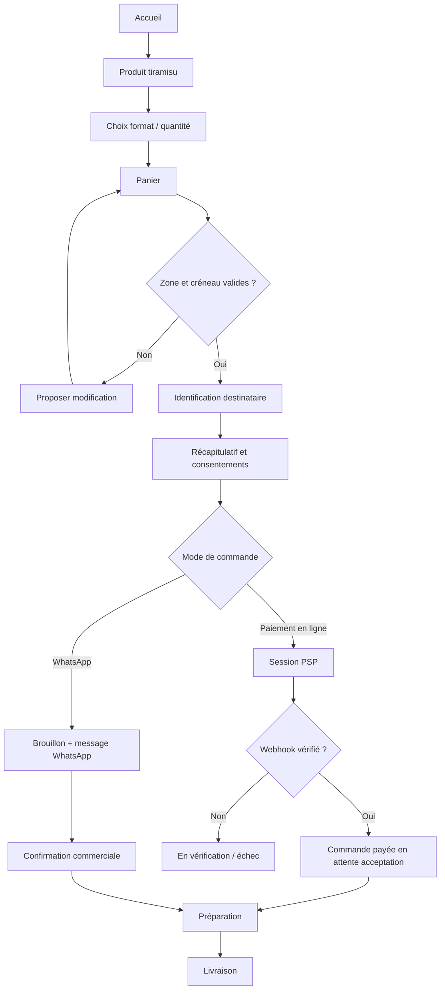

# Parcours utilisateurs et workflows

**MK DÉLICES** — Dossier de cadrage fonctionnel et technique

**Document 03/12** · Version 1.0 · 14 novembre 2026

---

## Gouvernance du document

| Champ | Valeur |
|---|---|
| Projet | MK Délices — Plateforme e-commerce pâtisserie |
| Version | 1.0 — cadrage initial du 14 novembre 2026 |
| Statut | Proposition de référence ; à valider par MK Délices |
| Localisation | Dakar, Sénégal |
| Monnaie / fuseau | XOF / Africa/Dakar (UTC+0) |
| Socle préconisé | React + TypeScript + Vite ; Laravel 13 / PHP ≥ 8.3 ; PostgreSQL |
| Hypothèses | Catalogue, prix, zones, frais, prestataires et identité visuelle à confirmer |

**Convention :** « DOIT » = exigence impérative ; « DEVRAIT » = souhaitable ; « option » = hors MVP ou à arbitrer. Les exemples de tarifs, d'adresses, de parfums et de durées ne constituent jamais des données commerciales officielles. Toutes les valeurs monétaires sont enregistrées en unités entières de XOF.

## 1. Cartographie navigation

**Public :** Accueil → Catégories → Fiche produit → Panier → Livraison → Paiement → Confirmation / Suivi. Menus : Notre histoire, FAQ, Contact, WhatsApp.

**Administrateur :** Connexion → Vue générale → Commandes → Préparation → Livraisons → Produits → Contenus → Zones/tarifs → Paiements → Rapports → Utilisateurs.

**Livreur :** Connexion → Mes missions → Détails → Accepter/refuser → Enlèvement → Livraison / incident → Historique.

## 2. Parcours client — commande en ligne

## 3. Acteurs, déclencheurs et résultats

| Acteur | Déclencheur | Écran | Sortie / erreur |
| --- | --- | --- | --- |
| Visiteur | Clique acheter | Produit / panier | Produit indisponible → alternative |
| Client | Valide le checkout | Livraison/confirmation | Zone hors service → blocage justifié |
| Commercial | Reçoit nouvelle commande | File nouvelles commandes | Refus → remboursement si payé |
| Préparateur | Commande acceptée | File préparation | Produit manquant → escalade |
| Responsable livraison | Commande prête | Affectation | Livreur indisponible → réaffecter |
| Livreur | Mission proposée | Mes missions | Refus → mission à réattribuer |
| Admin | Modifie tarification | Zones/tarifs | Versions recalculées seulement avant confirmation |

## 4. Gestion des exceptions

| Cas | Détection | UX et action serveur |
| --- | --- | --- |
| PSP en attente | Retour de page sans confirmation | Afficher en vérification, lancer rapprochement |
| Paiement échoué | Échec confirmé | Proposer nouvelle tentative sans dupliquer commande |
| Rupture lors du checkout | Recalcul atomique | Expliquer article non disponible, réviser panier |
| Créneau saturé | Quota dépassé | Proposer prochain créneau valide |
| Annulation avant préparation | Demande client | Appliquer politique et traitement paiement |
| Échec de livraison | Mission incidentée | Déclarer motif, contacter client, décision admin |
| Double clic Commander | Idempotency-Key répétée | Renvoyer même commande sans nouvelle transaction |
| Lien de suivi expiré | Jeton invalide/expiré | Proposer vérification identité plutôt que fuite de détails |

## 5. Événements et notifications

Événements métier : cart.created, order.created, order.accepted, order.preparing, order.ready, delivery.assigned, delivery.picked_up, delivery.delivered, payment.confirmed, payment.failed, refund.requested. Par défaut, notifier le client sur canal transactionnel autorisé et afficher le centre de notifications du back-office. Prévoir anti-duplication et journal d’envoi.

## 6. Traces et accessibilité

Chaque page doit posséder un état vide, chargement, réussite et erreur exploitable sur mobile. Le parcours est clavier compatible, les erreurs de formulaire sont rattachées aux champs, la validation serveur conserve les entrées non sensibles. Toutes les transitions sont auditées avec ancien état, nouvel état, acteur, identifiant de corrélation et heure UTC.

## Références et réserves

**Sources externes de vérification (consultées le 14/11/2026) :**
- https://laravel.com/framework/docs/13.x/releases
- https://docs.wave.com/business
- https://docs.wave.com/checkout
- https://espaceclientv2.orange.sn/orange-money/api-internet
- https://www.cdp.sn/legislation/textes-legislatifs
- https://www.cdp.sn/legislation/textes-reglementaires

Le présent document distingue faits du projet communiqués, recommandations de conception et décisions commerciales à confirmer. Les paramètres externes (PSP, tarification, obligations légales, contrats) doivent faire l objet de vérifications au moment de l implémentation.

## Approbation et contrôle de changement

| Rôle | Visa / date |
|---|---|
| Direction MK Délices | À compléter |
| Responsable produit / opérations | À compléter |
| Responsable technique | À compléter |

Toute modification après validation doit créer un historique de version, une justification et une analyse d impact sur les autres documents.
