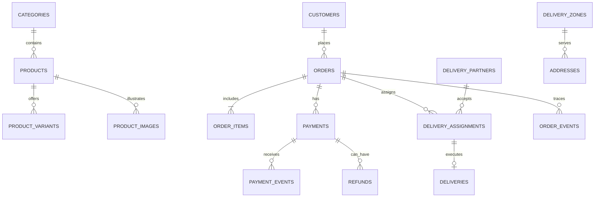

# Modèle de données et schéma backend

**MK DÉLICES** — Dossier de cadrage fonctionnel et technique

**Document 05/12** · Version 1.0 · 14 novembre 2026

---

## Gouvernance du document

| Champ | Valeur |
|---|---|
| Projet | MK Délices — Plateforme e-commerce pâtisserie |
| Version | 1.0 — cadrage initial du 14 novembre 2026 |
| Statut | Proposition de référence ; à valider par MK Délices |
| Localisation | Dakar, Sénégal |
| Monnaie / fuseau | XOF / Africa/Dakar (UTC+0) |
| Socle préconisé | React + TypeScript + Vite ; Laravel 13 / PHP ≥ 8.3 ; PostgreSQL |
| Hypothèses | Catalogue, prix, zones, frais, prestataires et identité visuelle à confirmer |

**Convention :** « DOIT » = exigence impérative ; « DEVRAIT » = souhaitable ; « option » = hors MVP ou à arbitrer. Les exemples de tarifs, d'adresses, de parfums et de durées ne constituent jamais des données commerciales officielles. Toutes les valeurs monétaires sont enregistrées en unités entières de XOF.

## 1. Conventions de modélisation

PostgreSQL avec UUID métier, timestamps timestamptz UTC, devise XOF, prix et frais en BIGINT positif, clés étrangères explicites, suppression RESTRICT pour transactions et historique, soft-delete seulement sur référentiels sélectionnés. Capturer prix, allergènes et adresse en snapshot immuable dans la commande. Nommer index `idx_<table>_<colonnes>` ; contraintes CHECK pour états et montants.

## 2. Dictionnaire des données

| Table | Champs principaux, types et contraintes | Rôle |
| --- | --- | --- |
| users | id uuid PK; name varchar(160); phone varchar(30) nullable; email varchar unique nullable; password_hash varchar nullable; is_active bool; created_at,updated_at timestamptz | Comptes staff/livreurs/clients |
| roles | id bigint PK; name varchar unique | RBAC |
| user_roles | user_id uuid FK; role_id bigint FK; PK(user_id,role_id) | Association |
| customers | id uuid PK; user_id uuid FK nullable; first_name; last_name; phone; marketing_consent_at timestamp nullable | Acheteurs invités ou comptes |
| addresses | id uuid PK; customer_id uuid FK nullable; zone_id uuid FK; district; landmark; lat numeric nullable; lng numeric nullable | Adresse client snapshot nécessaire à la commande |
| categories | id uuid PK; name; slug unique; active bool; position int | Catalogue |
| products | id uuid PK; category_id uuid FK; slug unique; name; description text; ingredients text; allergens jsonb; storage_instructions text; active bool | Fiche |
| product_variants | id uuid PK; product_id uuid FK; sku unique; label; price_xof bigint; available bool; prep_minutes int; stock_qty int nullable | Formats/prix |
| product_images | id uuid PK; product_id uuid FK; path; alt; sort_order | Images |
| carts | id uuid PK; customer_id uuid nullable; guest_token_hash; expires_at | Panier temporaire |
| cart_items | id uuid PK; cart_id uuid FK; variant_id uuid FK; quantity int | Lignes panier |
| orders | id uuid PK; reference varchar unique; customer_id uuid nullable; status varchar; payment_status varchar; fulfillment_type varchar; subtotal_xof bigint; discount_xof bigint; delivery_fee_xof bigint; total_xof bigint; currency char(3); address_snapshot jsonb; slot_start_at timestamptz; created_at | Vente |
| order_items | id uuid PK; order_id uuid FK; variant_id uuid FK; product_name_snapshot; variant_label_snapshot; unit_price_xof bigint; qty int; line_total_xof bigint; allergens_snapshot jsonb | Snapshot achat |
| payments | id uuid PK; order_id uuid FK; provider; provider_reference unique nullable; status; amount_xof bigint; idempotency_key unique; created_at | Transactions |
| payment_events | id uuid PK; payment_id uuid FK; provider_event_id unique; event_type; payload_redacted jsonb; received_at | Déduplication |
| refunds | id uuid PK; payment_id uuid FK; amount_xof bigint; provider_ref; status; reason | Remboursements |
| delivery_zones | id uuid PK; name; active bool; delivery_fee_xof bigint; min_order_xof bigint nullable | Tarifs |
| delivery_partners | id uuid PK; user_id uuid FK unique; phone; active bool; transport_mode | Livreurs |
| delivery_partner_zones | partner_id uuid FK; zone_id uuid FK; PK(partner_id,zone_id) | Couverture |
| delivery_assignments | id uuid PK; order_id uuid FK; partner_id uuid FK; status; assigned_at; accepted_at; closed_at | Mission |
| deliveries | id uuid PK; assignment_id uuid FK; picked_up_at; delivered_at; failed_at; proof_type; proof_reference; incident_note | Exécution |
| promotions | id uuid PK; code unique; discount_type; discount_value; starts_at; ends_at; usage_limit | Coupons |
| reviews | id uuid PK; order_id uuid FK; product_id uuid FK; stars int; moderation_status | Avis |
| content_pages | id uuid PK; slug unique; title; body; published_at | CMS |
| notifications | id uuid PK; recipient_id uuid; type; channel; delivery_status; sent_at | Communication |
| order_events | id uuid PK; order_id uuid FK; actor_id uuid nullable; from_status; to_status; reason; occurred_at; request_id | Audit commande |
| audit_logs | id uuid PK; actor_id uuid nullable; target_type; target_id; action; before_json jsonb; after_json jsonb; created_at | Audit applicatif |
| idempotency_keys | id uuid PK; scope; key unique; request_hash; response_json jsonb; expires_at | Anti-doublon |

## 3. Relations cardinales

- Une catégorie possède plusieurs produits ; un produit possède plusieurs variantes et images.
- Un panier contient plusieurs lignes ; chaque ligne pointe une variante active au moment de la validation.
- Une commande possède plusieurs lignes immuables et zéro à plusieurs tentatives de paiement.
- Un paiement possède plusieurs événements fournisseurs, dédupliqués par provider_event_id.
- Une commande peut avoir plusieurs affectations successives ; au plus une mission active.
- Une zone tarifaire dessert plusieurs adresses et plusieurs livreurs via table de jonction.
- Un client peut être invité et posséder plusieurs commandes ; identifiants publics non devinables.

## 4. Diagramme relationnel simplifié

## 5. Contraintes et index critiques

| Objet | Contrainte / index | Raison |
| --- | --- | --- |
| orders.reference | UNIQUE NOT NULL | Référence non duplicable |
| payments.provider_reference | UNIQUE WHERE NOT NULL | Éviter double paiement attribué |
| payment_events.provider_event_id | UNIQUE(provider, provider_event_id) si multi-prestataire | Webhook idempotent |
| delivery_assignments | Unique partiel sur order_id WHERE status IN (proposed,accepted,picked_up) | Une mission active maximum |
| orders.total_xof | CHECK >= 0 ; total = sous-total - remise + livraison | Montants cohérents |
| order_items.qty | CHECK qty > 0 | Quantités valides |
| reviews.stars | CHECK BETWEEN 1 AND 5 | Notes valides |
| orders.created_at | INDEX(created_at, status) | Tableaux de bord |

## 6. Migrations, audit, rétention

Ordre : identités → catégories/produits → zones/clients → paniers → commandes/lignes → paiements/événements → livraisons → CMS/promotions → audit. Faire migrations forward-only en production, migration additive puis bascule du code avant suppression de colonne. Jeux de démonstration exclusivement fictifs et explicitement identifiés. Journaliser changements de prix, rôles, commandes et statuts, sans conserver de payloads PSP secrets. Les durées de conservation des données sont à définir selon obligation légale et politique approuvée.

## 7. Invariants transactionnels

- Un état payment_status=paid exige une transaction fournisseur vérifiée.
- Le stock disponible ne peut devenir négatif ; réservation sous verrou avec expiration.
- Les montants des lignes sont snapshots et ne changent pas avec le catalogue.
- Aucune modification de statut ne contourne la machine à états.
- Une mission active ne peut appartenir à deux livreurs simultanément.
- Toute correction manuelle de paiement nécessite rôle habilité, motif et piste audit.

## Références et réserves

**Sources externes de vérification (consultées le 14/11/2026) :**
- https://laravel.com/framework/docs/13.x/releases
- https://docs.wave.com/business
- https://docs.wave.com/checkout
- https://espaceclientv2.orange.sn/orange-money/api-internet
- https://www.cdp.sn/legislation/textes-legislatifs
- https://www.cdp.sn/legislation/textes-reglementaires

Le présent document distingue faits du projet communiqués, recommandations de conception et décisions commerciales à confirmer. Les paramètres externes (PSP, tarification, obligations légales, contrats) doivent faire l objet de vérifications au moment de l implémentation.

## Approbation et contrôle de changement

| Rôle | Visa / date |
|---|---|
| Direction MK Délices | À compléter |
| Responsable produit / opérations | À compléter |
| Responsable technique | À compléter |

Toute modification après validation doit créer un historique de version, une justification et une analyse d impact sur les autres documents.
