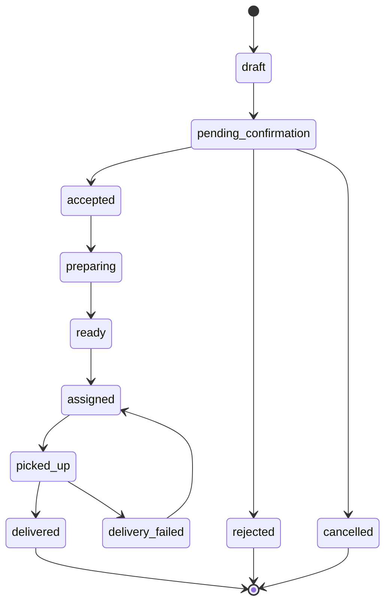

# Règles métier et machines à états

**MK DÉLICES** — Dossier de cadrage fonctionnel et technique

**Document 07/12** · Version 1.0 · 14 novembre 2026

---

## Gouvernance du document

| Champ | Valeur |
|---|---|
| Projet | MK Délices — Plateforme e-commerce pâtisserie |
| Version | 1.0 — cadrage initial du 14 novembre 2026 |
| Statut | Proposition de référence ; à valider par MK Délices |
| Localisation | Dakar, Sénégal |
| Monnaie / fuseau | XOF / Africa/Dakar (UTC+0) |
| Socle préconisé | React + TypeScript + Vite ; Laravel 13 / PHP ≥ 8.3 ; PostgreSQL |
| Hypothèses | Catalogue, prix, zones, frais, prestataires et identité visuelle à confirmer |

**Convention :** « DOIT » = exigence impérative ; « DEVRAIT » = souhaitable ; « option » = hors MVP ou à arbitrer. Les exemples de tarifs, d'adresses, de parfums et de durées ne constituent jamais des données commerciales officielles. Toutes les valeurs monétaires sont enregistrées en unités entières de XOF.

## 1. Définitions et séparation des états

Trois machines à états indépendantes : **commande** (draft, pending_confirmation, accepted, preparing, ready, assigned, picked_up, delivered, delivery_failed, cancelled, rejected) ; **paiement** (unpaid, pending, paid, failed, partially_refunded, refunded) ; **mission** (proposed, accepted, refused, picked_up, delivered, failed, cancelled). Ne jamais déduire l état paiement de l état logistique.

## 2. Transitions commande

| Départ | Arrivée | Garde / déclencheur |
| --- | --- | --- |
| draft | pending_confirmation | Validation panier |
| pending_confirmation | accepted | Accord commercial / conditions financières valides |
| pending_confirmation | cancelled | Abandon ou annulation autorisée |
| accepted | preparing | Début préparation |
| preparing | ready | Préparation finie et conditionnement contrôlé |
| ready | assigned | Mission acceptée par livreur |
| assigned | picked_up | Remise au livreur |
| picked_up | delivered | Preuve de remise valide |
| picked_up | delivery_failed | Incident de remise déclaré |
| delivery_failed | assigned | Nouvelle affectation autorisée |
| accepted / preparing | cancelled | Seulement après décision explicite et traitement financier |

## 3. Diagramme d états

## 4. Règles et contrôles

| ID | Règle | Contrôle |
| --- | --- | --- |
| BR-001 | Catalogue | Produit actif et variante vendable à la validation |
| BR-002 | Montant | Total serveur, en entier XOF, remise plafonnée |
| BR-003 | Zone | Zone active obligatoire avant validation |
| BR-004 | Créneau | Respect capacité et délai de préparation, verrou atomique |
| BR-005 | Paiement | Un webhook signé ou consultation PSP confirmée établit paid |
| BR-006 | Commande | Refus après paid déclenche demande de remboursement suivie |
| BR-007 | WhatsApp | Conversation préremplie ne confirme pas la commande |
| BR-008 | Livraison | Livreur actif et éligible à la zone |
| BR-009 | Mission | Un seul livreur actif par commande |
| BR-010 | Preuve | Remise horodatée, type de preuve requis |
| BR-011 | Annulation | Autorisations selon état et dépenses engagées |
| BR-012 | Périssable | Aucune préparation si produit impropre ; règles chaîne du froid approuvées |
| BR-013 | Remboursement | Montant cumulé remboursé ≤ montant réellement capturé |
| BR-014 | Concurrence | Version d état et transactions atomiques |
| BR-015 | Journal | Chaque transition possède identifiant acteur, motif et date |

## 5. Prix, remises et frais

Formule : `subtotal_xof = Σ (unit_price_snapshot × qty)` ; `discount_xof = min(remises_éligibles, subtotal_xof)` ; `total_xof = subtotal_xof - discount_xof + delivery_fee_xof`. Taxes et frais de service éventuels à ajouter seulement après validation comptable et juridique. Les frais de livraison proviennent de la zone active au moment du devis, et sont figés en snapshot à confirmation. Exiger l affichage d un total clair avant redirection de paiement.

## 6. Conflits et cas exceptionnels

En cas de confirmation client et annulation simultanées : `row_version` + transaction, une seule issue valide. Un prestataire peut renvoyer deux fois le même événement : déduplication externe obligatoire. À réception d un paiement tardif après annulation : suspendre exécution et créer dossier de remboursement. En cas d échec de remise : enregistrer incident, horaires, contact tenté, état sanitaire du produit, décision de relivraison ou annulation. Aucun remboursement implicite ni effacement de la commande.

## 7. Politique de qualité produit

Chaque fiche produit indique ingrédients/allergènes connus, instructions de conservation et temps de préparation. À la sortie atelier : contrôler conditionnement, quantité et exigence de froid adaptée à la recette. En cas de retard ou rupture de maîtrise du froid, définir procédure d escalade et non-livraison ; le seuil sanitaire exact doit être validé par MK Délices selon les produits et la réglementation applicable.

## Références et réserves

**Sources externes de vérification (consultées le 14/11/2026) :**
- https://laravel.com/framework/docs/13.x/releases
- https://docs.wave.com/business
- https://docs.wave.com/checkout
- https://espaceclientv2.orange.sn/orange-money/api-internet
- https://www.cdp.sn/legislation/textes-legislatifs
- https://www.cdp.sn/legislation/textes-reglementaires

Le présent document distingue faits du projet communiqués, recommandations de conception et décisions commerciales à confirmer. Les paramètres externes (PSP, tarification, obligations légales, contrats) doivent faire l objet de vérifications au moment de l implémentation.

## Approbation et contrôle de changement

| Rôle | Visa / date |
|---|---|
| Direction MK Délices | À compléter |
| Responsable produit / opérations | À compléter |
| Responsable technique | À compléter |

Toute modification après validation doit créer un historique de version, une justification et une analyse d impact sur les autres documents.
