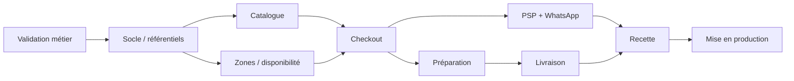

# Plan d’implémentation

**MK DÉLICES** — Dossier de cadrage fonctionnel et technique

**Document 09/12** · Version 1.0 · 14 novembre 2026

---

## Gouvernance du document

| Champ | Valeur |
|---|---|
| Projet | MK Délices — Plateforme e-commerce pâtisserie |
| Version | 1.0 — cadrage initial du 14 novembre 2026 |
| Statut | Proposition de référence ; à valider par MK Délices |
| Localisation | Dakar, Sénégal |
| Monnaie / fuseau | XOF / Africa/Dakar (UTC+0) |
| Socle préconisé | React + TypeScript + Vite ; Laravel 13 / PHP ≥ 8.3 ; PostgreSQL |
| Hypothèses | Catalogue, prix, zones, frais, prestataires et identité visuelle à confirmer |

**Convention :** « DOIT » = exigence impérative ; « DEVRAIT » = souhaitable ; « option » = hors MVP ou à arbitrer. Les exemples de tarifs, d'adresses, de parfums et de durées ne constituent jamais des données commerciales officielles. Toutes les valeurs monétaires sont enregistrées en unités entières de XOF.

## 1. Méthode d exécution

Livraison incrémentale en sprints courts, priorisée par risque : d abord intégration de paiement et contraintes métier, puis catalogue/commande, puis logistique. Le code n est pas généré par ce cadrage. Une validation propriétaire métier est nécessaire avant développement des parties engageant argent ou données personnelles.

## 2. Phasage et estimation de charge

| Phase | Lot | Travaux | Critère de sortie | Effort indicatif |
| --- | --- | --- | --- | --- |
| P0 | Validation métier | Catalogue, zones, CGV, règles froid, PSP | Décisions signées et périmètre figé | 3–5 jh |
| P1 | Socle technique | Monorepo, Laravel, React, CI, auth, DB | Build vert, migrations et accès contrôlé | 5–8 jh |
| P2 | Catalogue/vitrine | CMS, produits, variantes, médias, SEO | Navigation mobile et fiches complètes | 8–12 jh |
| P3 | Checkout/commande | Panier, devis, zones/créneaux, snapshots | Commande invitée et anti-doublon validés | 10–15 jh |
| P4 | Paiement/WhatsApp | Adaptateur PSP, sandbox, webhooks, brouillons | Tests paiement et idempotence verts | 8–14 jh |
| P5 | Préparation/livraison | Workflow, espaces admin et livreur | Scénario accepté→livré couvert | 10–16 jh |
| P6 | Qualité/recette | E2E, sécurité, performances, UAT | Zéro bloquant ouvert | 8–12 jh |
| P7 | Déploiement/formation | CI/CD, DNS, sauvegardes, procédures | Smoke test prod + formation | 4–7 jh |

## 3. Dépendances critiques

## 4. Backlog priorisé / Definition of Done

Chaque tâche : ID d exigence, objectif, dépendances, modèle, API, écran, règles d accès, test, logs et documentation. **DoD** : code revu, migrations réversibles ou stratégie expand/contract, test automatisé associé, cas d erreur, contrôle d habilitation, documentation à jour, build et lint réussis, capture de recette du parcours si UI. Aucun ticket clos avec paiement fictivement marqué « confirmé ».

## 5. Séquence opérationnelle du développement

- Initialiser Git, convention branches et versions ; ajouter README, .env.example et workflows.
- Configurer PostgreSQL, migrations, droits et seeders démonstration fictifs.
- Créer modèle produit/variant et administration des contenus.
- Construire homepage, catalogue, fiches et cart client sur mobile.
- Coder devis serveur et commandes transactionnelles avec Idempotency-Key.
- Implémenter PSP abstrait puis sandbox de prestataire réellement contractualisable.
- Ajouter brouillons WhatsApp, puis machine à états des commandes.
- Construire espace livreur et contrôles d affectation.
- Écrire tests sécurité, API et navigation E2E ; exécuter UAT.
- Configurer sauvegardes, métriques, alertes et plan de rollback ; ouvrir production après go/no-go.

## 6. Gouvernance et risques du planning

Réunion produit hebdomadaire ; arbitrages écrits via journal de décisions ADR ; démonstration en fin de sprint ; gel fonctionnel à l entrée UAT. Prévoir marge de 20 % sur les tâches dépendantes des PSP ou des partenaires. L estimation en jours-homme n est pas une promesse de calendrier calendaire sans effectifs et disponibilité décidés.

## 7. Livraison attendue par phase

P0 : registre décisions ; P1 : squelette et tests ; P2 : catalogue ; P3 : commandes traçables ; P4 : encaissement sandbox ; P5 : livraisons ; P6 : cahier de recette rempli ; P7 : exploitation documentée. Tous les livrables sont versionnés et associés à un responsable de validation.

## Références et réserves

**Sources externes de vérification (consultées le 14/11/2026) :**
- https://laravel.com/framework/docs/13.x/releases
- https://docs.wave.com/business
- https://docs.wave.com/checkout
- https://espaceclientv2.orange.sn/orange-money/api-internet
- https://www.cdp.sn/legislation/textes-legislatifs
- https://www.cdp.sn/legislation/textes-reglementaires

Le présent document distingue faits du projet communiqués, recommandations de conception et décisions commerciales à confirmer. Les paramètres externes (PSP, tarification, obligations légales, contrats) doivent faire l objet de vérifications au moment de l implémentation.

## Approbation et contrôle de changement

| Rôle | Visa / date |
|---|---|
| Direction MK Délices | À compléter |
| Responsable produit / opérations | À compléter |
| Responsable technique | À compléter |

Toute modification après validation doit créer un historique de version, une justification et une analyse d impact sur les autres documents.
