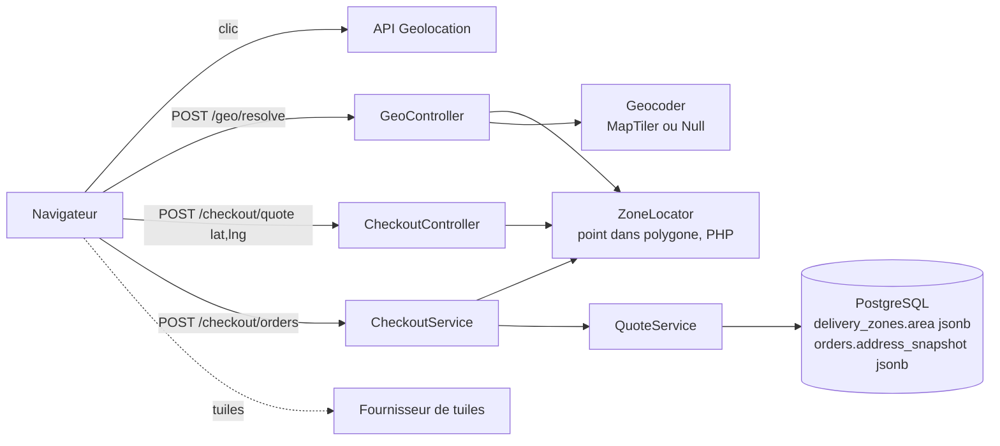

# 01 — Audit de l'existant : géolocalisation

**Pour :** équipe technique et direction de MK Délices.
**Date :** 18/11/2026.
**Base auditée :** commit `a17b8a9` + travaux de géolocalisation **non commités** trouvés dans l'arbre de travail.

**Méthode :**
- lecture du code (backend, frontend, migrations, configuration nginx) ;
- exécution des suites de tests avant toute modification.

Une fonction n'est dite « fonctionnelle » que si un test exécuté le prouve.

## 1. Point de départ

Le dépôt contenait deux couches :

1. **Socle livraison commité (`a17b8a9`)** :
   - zones avec frais, minimum et délai propres ;
   - devis calculé par le serveur ;
   - adresse figée dans la commande (`address_snapshot`) ;
   - livreurs, missions, code de remise.

   Constat initial détaillé : [annexes/A1-CONSTAT-INITIAL-a17b8a9.md](annexes/A1-CONSTAT-INITIAL-a17b8a9.md).
2. **Implémentation de géolocalisation non commitée** (session du 17/11/2026), jamais revue ni documentée dans le journal :
   - `backend/app/Domain/Geo/` (8 classes) ;
   - `GeoController` ;
   - migration `2026_11_18_090000_add_geolocation_to_zones_and_addresses` (déjà jouée sur la base locale) ;
   - `GeolocationTest` (21 tests) ;
   - `frontend/src/features/maps/` (Leaflet 1.9.4) ;
   - modifications du checkout, du compte, des zones, de la fiche commande et du tableau de bord.

**Tests exécutés à l'ouverture de l'audit :**

| Suite | Résultat |
|---|---|
| Backend PHPUnit | 173/173 réussis |
| Frontend Vitest | 19/19 réussis |
| Lint, typage, build | sans erreur |

## 2. Inventaire par module

Légende : ✅ fonctionnel et testé · 🟡 incomplet · 🔴 défaillant · ⬜ absent.

### 2.1 Localisation du client

| Exigence | État initial | Constat | Fichiers |
|---|---|---|---|
| Autorisation demandée explicitement | ✅ | GPS demandé uniquement au clic sur « Utiliser ma position actuelle » | `features/maps/geo.ts` (`geolocate`) |
| Détection avec consentement | ✅ | Haute précision, délai 15 s, précision affichée | `LocationPicker.tsx` |
| Saisie manuelle | ✅ | Zone + quartier + rue + repère, toujours suffisante | `checkout.tsx` |
| Carte interactive (repère déplaçable) | 🟡 | Codée (Leaflet), mais **inactive** sans `MAPS_TILES_URL`. De plus, la CSP nginx (`img-src 'self' data: blob:`) **aurait bloqué les tuiles** une fois la carte activée | `LeafletMaps.tsx`, `deploy/nginx/snippets/mk-security-headers.conf` |
| Géocodage inverse (point → quartier) | 🟡 | `MapTilerGeocoder`, côté serveur. Inactif sans clé ; format de réponse non vérifié sur un compte réel | `Domain/Geo/MapTilerGeocoder.php` |
| Recherche d'adresse | 🟡 | Idem, limitée à la région (bbox) et au pays `sn` | `GeoController::search` |
| Confirmation, correction | ✅ | Confirmation explicite obligatoire ; « Modifier » et « Retirer » | `LocationPicker.tsx` |
| Quartiers, repères propres à Dakar | ✅ | Champs « Quartier » et « Point de repère » ; quartier suggéré par le géocodage | — |
| Plusieurs adresses | 🟡 | Ajout et suppression seulement. **Pas de modification** ; **pas de champ « rue »** dans le formulaire du compte | `account.tsx` |
| Adresse par défaut | 🔴 | Colonne `is_default` présente mais **aucune logique** : plusieurs défauts possibles, aucun moyen de la définir dans l'interface, pas de présélection au checkout | `AccountController.php` |

### 2.2 Panier et validation

| Exigence | État | Constat |
|---|---|---|
| Choix de l'adresse | 🟡 | Liste « Mes adresses » au checkout, mais l'adresse par défaut n'est pas présélectionnée |
| Zone desservie vérifiée | ✅ | `ZoneLocator` : la zone est déduite de la position dès qu'une zone a un contour. Hors contour : commande refusée (`out_of_zone`) |
| Frais calculés par le serveur | ✅ | `QuoteService` reste la seule source ; le client ne transmet jamais de montant |
| Frais affichés avant validation | ✅ | Récapitulatif alimenté par `POST /checkout/quote` |
| Cohérence adresse ↔ position ↔ montant | 🔴 | Avec une adresse enregistrée **dont la zone a été redessinée**, la liste affichait l'ancienne zone alors que le serveur facturait la nouvelle |
| Recalcul après modification | 🔴 | Le devis se recalcule bien. Mais le bouton « Confirmer » restait actif **pendant** le recalcul : le client pouvait valider un total périmé (refus 409 au lieu d'un parcours fluide). **Défaut découvert par le test E2E de cet audit** |
| Montant protégé | ✅ | `expected_total_xof` : refus 409 `total_changed` si le total a changé |
| Adresse conservée | ✅ | `address_snapshot` enrichi (`lat`, `lng`, `location_source`, `accuracy_m`, `zone_source`) |

### 2.3 Zones de livraison (administration)

| Exigence | État | Constat |
|---|---|---|
| Zones, frais, minimum, activation | ✅ | `ZonesPage`, `ReferenceDataController::saveZone`, avec journal d'audit |
| Quartiers et secteurs | ✅ | Liste textuelle `districts` |
| Polygones | ✅ | GeoJSON validé (bornes de Dakar, 500 sommets au plus, trous et multipolygones) ; éditeur sur carte ou import GeoJSON |
| Carte des zones | 🟡 | Dans l'éditeur seulement, et seulement si un fond de carte est configuré |
| Distance maximale | ⬜ | Non pertinent avec des zones dessinées (le contour fait office de limite) |
| Créneaux, restrictions par zone | 🟡 | Délai supplémentaire et minimum par zone ; créneaux globaux |
| Message hors zone | 🟡 | Le message parlait de WhatsApp **sans lien** |
| Configuration sans code | ✅ | Tout se fait par le back-office |

Aucune zone de démonstration n'a de contour : la base locale tourne en mode « zone déclarée ».

### 2.4 Distances et frais

| Exigence | État | Constat |
|---|---|---|
| Méthode de distance | ✅ | Haversine (`GeoPoint::distanceTo`) : vol d'oiseau, **jamais** utilisée pour un prix |
| Distance routière, itinéraire | ⬜ | Aucun service de routage (choix assumé, voir 03 § 4) |
| Tarif par zone | ✅ | Forfait de la zone |
| Livraison gratuite | ⬜ | Les promotions ne gèrent que `percent` et `fixed` |
| Estimation = facturation | ✅ | Même `QuoteService` pour le devis et la commande, plus `expected_total_xof` |

### 2.5 Livreurs

| Exigence | État | Constat |
|---|---|---|
| Affectation, statuts, preuve, échec | ✅ | Existant (`DeliveryService`, machine à états, code de remise, règle « contact + 10 min ») |
| Adresse et itinéraire | ✅ | Lien `google.com/maps/dir` vers les coordonnées (ouvre l'application du téléphone) ; à défaut, recherche textuelle |
| Confidentialité | ✅ | Coordonnées visibles **seulement** pendant la mission acceptée (`MissionResource`, testé) |
| Suivi GPS en temps réel | ⬜ | Volontairement absent (voir 03 § 5) |

### 2.6 Suivi de commande (client)

✅ Suivi par statuts, avec le code de remise. Aucune position n'est exposée sur la page publique : `PublicOrderResource` ne renvoie que la zone et le quartier.

### 2.7 Administration

| Exigence | État | Constat |
|---|---|---|
| Commandes par zone | 🔴 | **Aucun filtre par zone** dans la liste des commandes |
| Adresses de livraison, position | ✅ | Fiche commande : lien carte, origine et précision de la position ; alerte « zone non vérifiée » |
| Commandes à zone non vérifiée | 🟡 | Alerte sur la fiche seulement, pas de filtre |
| Statistiques par zone | ✅ | Tableau « Par zone de livraison » (agrégats seulement) |
| Accès aux positions | ✅ | `OrderResource` : adresse complète seulement pour les profils qui voient les coordonnées ; tests de permissions |

## 3. Architecture technique constatée

- **Base de données :**
  - `delivery_zones.area` (jsonb) ;
  - `addresses.lat/lng/location_source/location_accuracy_m` ;
  - `orders.address_snapshot` (jsonb).
- **Pas de PostGIS** : moins de 20 zones, test en PHP. Choix justifié (voir 03 § 3).
- **Sécurité :**
  - limiteur `geo` (20 requêtes par minute) ;
  - clé de géocodage côté serveur seulement (testé) ;
  - `Permissions-Policy: geolocation=(self)`.

## 4. Anomalies relevées

| ID | Gravité | Anomalie |
|---|---|---|
| A-01 | Haute | La CSP nginx bloque les tuiles du fond de carte : la carte serait restée **grise** en production après configuration de la clé |
| A-02 | Haute | Validation du checkout possible pendant le recalcul du devis : total périmé envoyé, refus 409 (découvert en E2E) |
| A-03 | Moyenne | Zone affichée différente de la zone facturée avec une adresse enregistrée dont la zone a changé |
| A-04 | Moyenne | Adresse par défaut non gérée (plusieurs défauts possibles, aucune action, pas de présélection) |
| A-05 | Moyenne | Adresses du compte non modifiables ; champ « rue » absent du formulaire |
| A-06 | Moyenne | Pas de filtre par zone ni par « zone non vérifiée » dans la liste des commandes |
| A-07 | Basse | Libellé erroné : `staff` affichait « Position conservée… » alors qu'il désigne une position **saisie** par l'équipe |
| A-08 | Basse | Bornes GPS codées en dur dans `PlaceOrderRequest`, en double avec `mkdelices.maps.bounds` ; une latitude sans longitude était ignorée en silence |
| A-09 | Basse | Chaque clic sur la carte déclenchait un appel `/geo/resolve`, potentiellement facturé : risque de dépasser la limite de 20 par minute en ajustant le repère |
| A-10 | Basse | Message hors zone sans lien WhatsApp ni rappel du retrait |
| A-11 | Moyenne | Aucune durée de conservation des positions GPS dans les commandes |
| A-12 | Basse | Commentaires du code pointant vers des documents inexistants (`04_APP_FLOW…`, `07_CONTRATS_API…`) ; travaux absents du journal |
