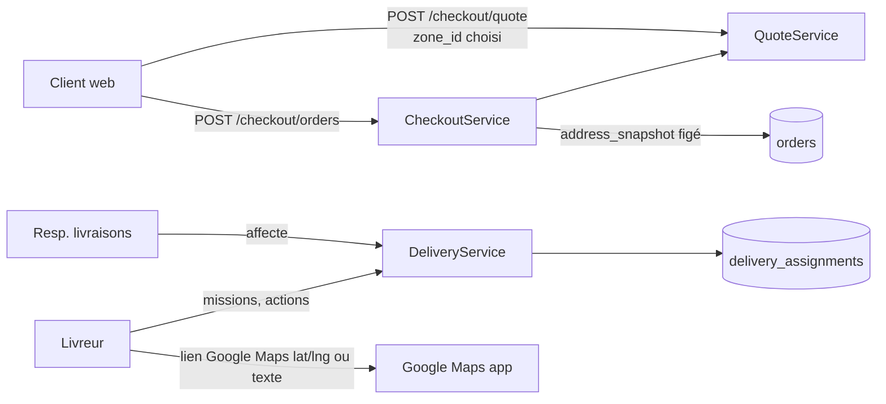

# Annexe A1 — Constat initial (commit a17b8a9, 17/11/2026)

> Note du 18/11/2026 : premier constat, rédigé AVANT l'implémentation. Conservé pour la traçabilité. L'état à jour est dans `../01-AUDIT-EXISTANT.md`. Les fichiers 03_TRD, 04_APP_FLOW, 07_CONTRATS_API et 08_PLAN qu'il cite n'ont jamais été écrits : leur contenu utile est repris dans les livrables 03, 04 et 07.

## 1. Synthèse

MK Délices dispose déjà d'un **socle de livraison complet et testé**. Il couvre :
- les zones avec frais, minimum de commande et délai propres ;
- le devis calculé côté serveur et l'adresse figée dans chaque commande ;
- les livreurs, leurs zones, l'affectation et la machine à états des missions ;
- la preuve de remise par code et les règlements des livreurs.

**La géolocalisation, elle, est quasi absente.**
- Les colonnes `lat`/`lng` existent et l'API de commande les accepte, mais **aucune interface ne les remplit**.
- Il n'y a ni carte, ni bouton « ma position », ni contrôle automatique de la zone, ni tarif à la distance, ni suivi du livreur.
- Le client **choisit lui-même sa zone** dans une liste : rien ne vérifie que le quartier saisi appartient à cette zone.

Le travail consiste donc à **enrichir** ce socle, pas à le remplacer. Trois décisions de MK Délices conditionnent la suite (§ 10).

## 2. Architecture actuelle (vérifiée)

| Couche | Technologie (versions lues dans le dépôt) |
|---|---|
| Backend | Laravel 13.42, PHP 8.5, PostgreSQL 18, Sanctum (cookies pour le site, jetons Bearer pour le mobile), Spatie Permission |
| Frontend | React 19, TypeScript, Vite 8, TanStack Query, react-hook-form + zod, Tailwind |
| Mobile | **Aucun code Flutter dans le dépôt.** Seule l'API mobile existe (`docs/API-MOBILE.md`) |
| Infra | Préproduction sur un VPS Hostinger (Ubuntu 26.04, nginx, supervisor), CI GitHub Actions (PostgreSQL 18 **sans PostGIS**) |
| Géospatial | PostGIS 3.6 **disponible** en local et **installable** sur le serveur (paquet `postgresql-18-postgis-3`), **non activé** |

## 3. Fonctionnalités existantes

Légende : ✅ existante et fonctionnelle (testée) · 🟡 existante mais incomplète · 🔴 existante mais défaillante · ⬜ absente · ❔ non vérifiable.

| Domaine | État | Constat | Fichiers |
|---|---|---|---|
| Catalogue, panier, checkout | ✅ | Parcours complet, tests PHPUnit et E2E | `app/Domain/Cart/`, `app/Domain/Orders/CheckoutService.php`, `frontend/src/pages/checkout.tsx` |
| Zones de livraison (administration) | ✅ | Créer, modifier, désactiver ; frais client, minimum, rémunération livreur, délai supplémentaire, liste de quartiers en **texte libre** | `Admin/ReferenceDataController.php` (`saveZone`), `frontend/src/pages/admin/operations/ZonesPage.tsx` |
| Liste publique des zones | ✅ | `GET /delivery/zones` | `ContentController.php:42-48` |
| Frais de livraison | ✅ | Calculés **côté serveur** à partir de la zone ; minimum par zone ; recalculés à la création de la commande (`lock: true`) | `app/Domain/Cart/QuoteService.php:68-82`, `CheckoutService.php:63-64` |
| Historisation des montants et adresses | ✅ | `address_snapshot`, montants copiés dans la commande ; modifier l'adresse d'un client ne touche pas les commandes | `CheckoutService.php:399-410` |
| Saisie de l'adresse au checkout | 🟡 | Zone (liste), quartier, rue, repère. **Pas de coordonnées envoyées**, pas de carte, pas de choix parmi les adresses enregistrées | `checkout.tsx:162-174, 285, 379-397` |
| Coordonnées à la commande | 🟡 | `delivery.lat/lng` acceptées, bornées à la région de Dakar (lat 14,0–15,2 ; lng −17,8 à −16,8), copiées dans l'adresse figée, **jamais fournies par le site** | `PlaceOrderRequest.php:29-30`, `CheckoutService.php:240-241, 406-407` |
| Carnet d'adresses du client | 🟡 | Ajouter, modifier, supprimer, adresse par défaut. **Les coordonnées sont ignorées** par la validation alors que le modèle les prévoit | `AccountController.php:78-88`, `Models/Address.php:13-17` |
| Vérification que l'adresse est dans la zone | ⬜ | Le client déclare sa zone ; seul le commercial peut repérer une erreur | — |
| Zones dessinées (polygones) | ⬜ | — | — |
| Géocodage (adresse → point, point → quartier) | ⬜ | — | — |
| Distance et itinéraire | ⬜ | — | — |
| Tarif à la distance | ⬜ | — | — |
| Délai estimé | 🟡 | Délai minimal de commande + délai de zone ; créneaux de 2 h. Pas d'estimation de trajet | `QuoteService.php:100` |
| Livreurs, zones d'intervention, disponibilité | ✅ | Livreur déclaré par zone ; affectation refusée hors zone ou si indisponible | `DeliveryService.php:43-95` |
| Affectation et suggestions | 🟡 | Affectation manuelle, réaffectation, refus et « rendre » tracés. La liste ne propose que les livreurs éligibles, **sans tri par proximité** | `DeliveryService.php`, `DeliveryBoardPage.tsx` |
| Machine à états logistique | ✅ | Mission : proposée → acceptée → enlevée → livrée / échec / annulée. **Séparée** du statut commercial de la commande | `app/Domain/Deliveries/AssignmentStatus.php` |
| Navigation du livreur | 🟡 | Lien « Itinéraire » vers Google Maps : coordonnées si présentes (jamais aujourd'hui), sinon texte « rue, repère, quartier, Dakar », souvent imprécis | `useCourier.ts:30-33`, `MissionResource.php:38-39` |
| Confidentialité côté livreur | ✅ | Adresse, téléphone et coordonnées visibles **seulement** pendant la mission acceptée | `MissionResource.php:22-40` |
| Suivi de commande par le client | ✅ | Page de suivi par jeton (statuts, code de remise) | `frontend/src/pages/orders.tsx` |
| Suivi GPS du livreur | ⬜ | — | — |
| Statistiques géographiques | ⬜ | Le tableau de bord n'a aucune ventilation par zone ou quartier | `app/Domain/Reporting/StatsService.php` |
| Notifications | ✅ | Emails client, notifications internes, notifications navigateur aux livreurs | `app/Notifications/`, `Deliveries/Push/` |
| WhatsApp | ✅ | Brouillon de commande avec zone ; saisie par le commercial | `CheckoutService::saveWhatsAppDraft` |
| Application Flutter | ❔ | Absente du dépôt : non vérifiable | — |

## 4. Lacunes

| ID | Lacune | Effet métier |
|---|---|---|
| GAP-01 | Aucune capture de la position (bouton GPS, carte, repère déplaçable) | Le livreur cherche l'adresse et appelle le client ; pertes de temps, produits frais exposés |
| GAP-02 | Zone **déclarée** par le client, jamais contrôlée | Mauvaise zone choisie, par erreur ou pour payer moins : frais faux, livreur non éligible, minimum non appliqué |
| GAP-03 | Zones décrites en texte (« quartiers ») et non sur une carte | Impossible d'automatiser l'éligibilité ; limites floues entre zones |
| GAP-04 | Coordonnées ignorées par le carnet d'adresses et le checkout | Le champ prévu ne sert jamais |
| GAP-05 | Le checkout ne propose pas les adresses enregistrées | Ressaisie à chaque commande, erreurs |
| GAP-06 | Pas de tarif à la distance ni d'estimation de trajet | Acceptable aujourd'hui : la décision D-ZONE-01/02 fixe des **frais par zone** |
| GAP-07 | Pas de statistiques par zone ou quartier | Pilotage commercial limité |
| GAP-08 | Pas de suivi du livreur | Le client ne sait pas où en est sa livraison, sauf par appel |
| GAP-09 | Le point de départ (atelier) n'est pas paramétré | Prérequis à tout calcul de distance |

## 5. Incohérences

| ID | Incohérence | Fichiers |
|---|---|---|
| INC-01 | `Address` déclare `lat`/`lng` comme remplissables, mais `validateAddress` ne les accepte pas : elles restent toujours vides | `Models/Address.php:13`, `AccountController.php:78-88` |
| INC-02 | La commande accepte les coordonnées, mais aucun client (site ou commercial) ne les envoie | `PlaceOrderRequest.php:29-30`, `checkout.tsx:285` |
| INC-03 | Le brouillon WhatsApp et la modification par le commercial ne transmettent jamais de coordonnées | `CheckoutService.php:128-160, 204-245` |
| INC-04 | Si les frais d'une zone changent entre l'affichage du devis et la validation, la commande est créée au nouveau prix **sans que le client soit prévenu** avant validation (il voit le nouveau total ensuite, avant de payer) | `CheckoutService.php:63` (recalcul sans montant attendu) |

## 6. Risques techniques

| ID | Risque | Niveau | Mesure |
|---|---|---|---|
| RT-01 | La CSP actuelle (`img-src 'self' data: blob:`, `connect-src 'self'`) **bloquera** les fonds de carte et le géocodage d'un fournisseur externe | Élevé | Ouvrir **uniquement** les domaines du fournisseur retenu (nginx et `SecurityHeaders`) |
| RT-02 | PostGIS absent de la CI ; l'activer impose une image PostgreSQL spécifique et une extension en production | Moyen | Avec moins de 20 zones, le test « point dans un polygone » se fait en PHP, sur des polygones en GeoJSON (`jsonb`). PostGIS reste une évolution possible |
| RT-03 | Dépendance à un service cartographique (panne, quota, coût) | Élevé | Repli **toujours** possible sur la saisie manuelle (zone + quartier + repère), jamais de checkout bloqué |
| RT-04 | Bibliothèque de carte lourde sur des mobiles en 3G | Moyen | Chargement de la carte à la demande (code séparé), carte non obligatoire |
| RT-05 | Précision GPS variable en intérieur à Dakar | Moyen | Afficher la précision et demander d'ajuster le repère si elle dépasse 50 m |

## 7. Risques métier

| ID | Risque | Mesure |
|---|---|---|
| RM-01 | Limites de zones inventées par l'équipe technique | Les polygones sont **dessinés par MK Délices** dans le back-office ; aucun n'est créé sans validation |
| RM-02 | Point juste sur la frontière de deux zones | Règle : zone de **plus faible priorité numérique** (configurable), sinon la moins chère, à valider |
| RM-03 | Adresse hors zone | Pas de commande en ligne ; proposition de contacter MK Délices par WhatsApp (livraison sur devis traitée par le commercial) |
| RM-04 | Le client refuse le GPS | La saisie manuelle reste complète et suffit à commander |
| RM-05 | Tarif à la distance non validé | Désactivé par défaut ; activable seulement après décision et paramétrage |

## 8. Risques de sécurité et de confidentialité

| ID | Risque | Mesure |
|---|---|---|
| RS-01 | La position est une donnée personnelle (loi sénégalaise 2008-12, CDP) | Collecte sur action du client uniquement, finalité affichée, précision limitée à l'adresse de livraison, conservation alignée sur celle des commandes |
| RS-02 | Clés d'API du fournisseur exposées dans le navigateur | Clé « navigateur » restreinte au domaine (référent HTTP) ; clé serveur séparée dans `.env`, jamais dans Git |
| RS-03 | Proxy de géocodage ouvert à tous (abus, coûts) | Appels serveur limités en débit, réservés au checkout et aux comptes, mis en cache selon la licence |
| RS-04 | Suivi GPS du livreur : surveillance excessive | Seulement pendant une mission en cours, arrêt automatique, positions purgées, jamais de position exacte affichée en public |
| RS-05 | Coordonnées falsifiées pour obtenir une zone moins chère | Le serveur recalcule la zone à partir du point. En cas de désaccord entre la zone et le quartier, le commercial vérifie avant d'accepter |

## 9. Ce qui peut être réutilisé

- `QuoteService`, déjà source unique de vérité pour les frais : la détermination automatique de la zone s'y branche.
- `address_snapshot` et le modèle `Address` accueillent déjà `lat`/`lng`.
- La machine à états des missions, les permissions (`zones.manage`, `deliveries.assign`, `courier.missions`) et la visibilité restreinte du livreur.
- `ZonesPage`, à compléter d'un éditeur de polygone.
- Le lien d'itinéraire, qui devient précis dès qu'il y a des coordonnées.
- Le rafraîchissement automatique de l'espace livreur et de la page de suivi : il couvre déjà un suivi simple, **sans** WebSocket.

## 10. Recommandations et décisions à prendre

| ID | Décision | Recommandation |
|---|---|---|
| **DEC-GEO-01** | Fournisseur cartographique | Fonds de carte OpenStreetMap via un **fournisseur commercial** (MapTiler, Stadia…) affiché avec MapLibre/Leaflet, derrière une interface interchangeable. Google Maps reste possible : meilleure recherche d'adresse, mais coûts et licence plus contraignants (§ 03_TRD). **Jamais** les serveurs publics d'OpenStreetMap en production |
| **DEC-GEO-02** | Stratégie de tarif | **Garder les frais par zone** (décision D-ZONE-01/02), avec zone **déterminée automatiquement** par le point. Tarif à la distance prévu mais désactivé |
| **DEC-GEO-03** | Suivi GPS du livreur en temps réel | **Reporter** (lot 8). Aujourd'hui : statuts de mission + lien d'itinéraire précis. Sur le web, le suivi s'arrête dès que le téléphone se verrouille ; il n'est fiable que dans une application native |
| DEC-GEO-04 | Limites des zones et position de l'atelier | À fournir par MK Délices (dessin dans le back-office) |

## 11. Matrice des écarts

| Exigence (prompt) | Existant | Écart | Lot |
|---|---|---|---|
| Position GPS du client | ⬜ | Bouton, carte, repère, confirmation | 2 |
| Saisie manuelle | ✅ | Ajouter le choix d'une adresse enregistrée | 2, 5 |
| Correction sur carte | ⬜ | Repère déplaçable | 2 |
| Carnet d'adresses | 🟡 | Accepter et afficher les coordonnées | 2 |
| Zones par polygone | ⬜ | Stockage GeoJSON, éditeur, contrôle d'éligibilité | 3 |
| Frais côté serveur | ✅ | Zone déduite du point et contrôlée | 4 |
| Devis daté et protégé | 🟡 | Montant attendu à la validation (INC-04) | 4, 5 |
| Distance routière, tarif kilométrique | ⬜ | Service de routage, stratégie configurable désactivée par défaut | 4 |
| Checkout enrichi | 🟡 | Carte facultative et vérification de la zone | 5 |
| Navigation du livreur | 🟡 | Coordonnées fiables, petite carte de la mission | 6 |
| Suggestion de livreur | 🟡 | Tri par zone et par charge | 6 |
| Tableau de bord géographique | ⬜ | Volumes et frais par zone, carte agrégée | 7 |
| Suivi GPS en temps réel | ⬜ | Selon DEC-GEO-03 | 8 |
| Contrats API mobile | 🟡 | OpenAPI des nouveaux points d'API | 9 |
| CSP, sécurité, conservation | 🟡 | Domaines du fournisseur, limitation de débit, purge | 10 |

## 12. Plan de correction

Le détail des lots, leurs dépendances et leurs critères d'acceptation figurent dans `08_PLAN_IMPLEMENTATION.md`. Ce qui peut avancer **sans** décision :
- les fondations (validation des coordonnées, point dans un polygone, interface fournisseur) ;
- le carnet d'adresses avec coordonnées (INC-01) ;
- la protection du montant au checkout (INC-04) ;
- le bouton « Utiliser ma position » (API du navigateur, sans fournisseur) ;
- la détermination automatique de la zone dès que des polygones existent ;
- les statistiques par zone.

**La carte interactive et le géocodage attendent DEC-GEO-01.**

**Sources consultées le 17/11/2026 :** [FAQ facturation Google Maps Platform](https://developers.google.com/maps/billing-and-pricing/faq?hl=en), [tarifs MapTiler Cloud](https://www.maptiler.com/cloud/pricing/), [politique d'usage des tuiles OSM](https://operations.osmfoundation.org/policies/tiles/), [politique d'usage de Nominatim](https://operations.osmfoundation.org/policies/nominatim/).
